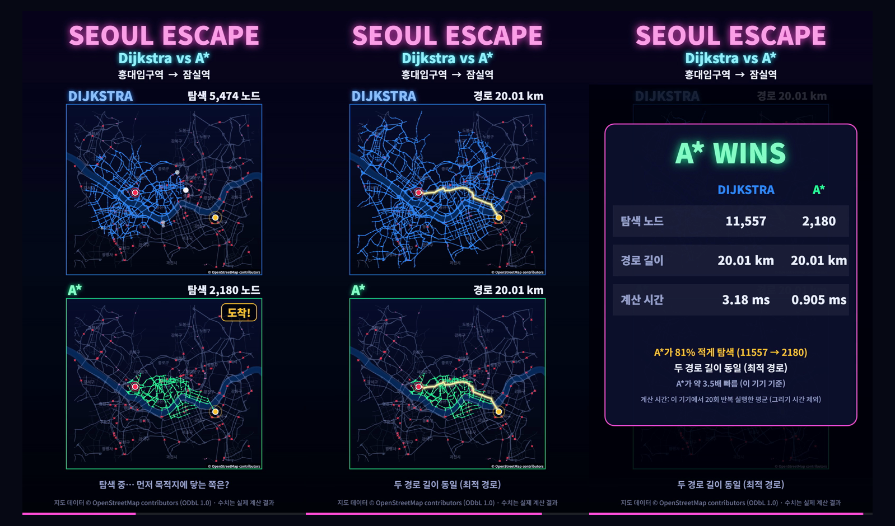
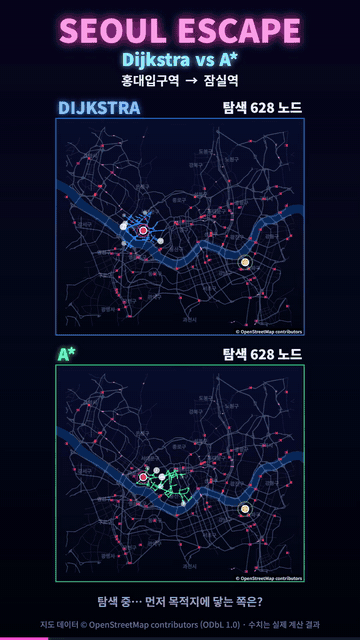

# SEOUL ESCAPE: Dijkstra vs A*

한국어 · [English](#english)

서울 도로망 위에서 **다익스트라**와 **A\*** 알고리즘이 누가 먼저 목적지에 도착하는지 겨루는 브라우저 게임입니다.

## ▶ 지금 해보기
**https://skadnrwhd-web.github.io/seoul-escape/**

설치나 가입 없이 브라우저(Chrome 권장)에서 바로 실행됩니다. 폰에서도 됩니다.

## 이런 게임이에요
- 같은 지도, 같은 출발지, 같은 목적지에서 두 알고리즘이 동시에 달립니다.
- 먼저 목적지에 닿는 쪽이 이깁니다. 끝나면 **탐색한 교차로 수 · 경로 길이 · 계산 시간**을 비교해 줍니다.
- 두 알고리즘 모두 **최단 경로**를 찾습니다. 다른 점은 길을 찾기 위해 얼마나 많은 곳을 뒤졌는가입니다.
  A\*는 "목적지 방향"을 힌트로 써서 덜 헤맵니다.

예시 (실제 서울 지도 · 보통 난이도 · 홍대입구역 → 잠실역)

| | 다익스트라 | A\* |
|---|---|---|
| 탐색한 교차로 | 11,557 | 2,180 |
| 경로 길이 | 20.01 km | 20.01 km |

## 두 가지 지도
- **가상 서울**: 서울의 구조(한강, 다리, 구 이름)를 흉내 낸 자체 생성 지도입니다. 실제 서울 지도가 아닙니다.
- **실제 서울 (OSM)**: OpenStreetMap의 실제 도로망입니다 (약 1만 9천 개 교차로, 일방통행 반영).

## 조작
- ▶ 시작 / ❚❚ 일시정지 / ▶ 재개 / ↺ 재시작 / ⏭ 결과 보기
- 경로 선택, 출발점·목적지 직접 지정(지도 클릭), 난이도, 장애물(통제 도로) 재배치, 속도 조절
- 🎬 영상 만들기: 현재 경주를 세로 영상으로 저장합니다. 이 공개 사이트에서는 브라우저 녹화(WebM)로 저장됩니다.

## 알아 둘 점
- 지도 비용은 도로를 따라간 **거리**만 반영합니다. 신호, 정체, 회전 금지, 제한속도는 반영하지 않습니다.
- 난이도의 빨간 X(통제 구간)는 게임용 가상 설정이며 실제 교통 정보가 아닙니다.
- 계산 시간은 실행한 기기와 브라우저에 따라 달라집니다. 작은 차이는 "비슷함"으로 표시합니다.
- 이 저장소는 공개용 배포 파일입니다.

## 지도 데이터 출처
실제 서울 지도 데이터: **© OpenStreetMap contributors**, [ODbL 1.0](https://opendatacommons.org/licenses/odbl/1-0/) 라이선스. 데이터 기준일 2026-10-25.
자세한 내용: https://www.openstreetmap.org/copyright

## 응원하기
- ⭐ 마음에 드셨다면 이 저장소 오른쪽 위의 **Star** 를 눌러 주세요. 큰 힘이 됩니다.
- ☕ 커피 한 잔으로 응원해 주세요: [Buy Me a Coffee](https://buymeacoffee.com/ujnam80)

---

## English

**SEOUL ESCAPE** is a browser game where **Dijkstra** and **A\*** race each other across the Seoul road network to see who reaches the destination first.

### ▶ Play now
**https://skadnrwhd-web.github.io/seoul-escape/**

No install and no sign-up. It runs in the browser (Chrome recommended), including on your phone.

### What it is
- Both algorithms run at the same time on the same map, from the same start to the same destination.
- Whoever reaches the destination first wins. When the race ends, it compares **intersections searched, route length and computation time**.
- Both algorithms find the **shortest route**. The difference is how many places they search along the way. A\* uses the direction of the destination as a hint, so it wanders less.

Example (real Seoul map, normal difficulty, Hongik Univ. Station to Jamsil Station)

| | Dijkstra | A\* |
|---|---|---|
| Intersections searched | 11,557 | 2,180 |
| Route length | 20.01 km | 20.01 km |

### Two maps
- **Virtual Seoul**: a generated map that imitates Seoul's structure (the Han River, bridges, district names). It is not the real Seoul map.
- **Real Seoul (OSM)**: the real OpenStreetMap road network (about 19,000 intersections, one-way streets included).

### Controls
- ▶ Start / ❚❚ Pause / ▶ Resume / ↺ Restart / ⏭ Show result
- Pick a route, set the start and destination by clicking the map, choose a difficulty, reshuffle the blocked roads, and change the speed.
- 🎬 Make video: saves the current race as a vertical video. On this public site it is saved as a browser recording (WebM).

### Good to know
- Map cost counts only the **distance** along the roads. Traffic lights, congestion, turn bans and speed limits are not included.
- The red X marks (blocked roads) on harder difficulties are a made-up game setting, not real traffic information.
- Computation time depends on your device and browser. Small differences are shown as "similar".
- This repository holds the public release files.

### Map data credit
Real Seoul map data: **© OpenStreetMap contributors**, licensed under [ODbL 1.0](https://opendatacommons.org/licenses/odbl/1-0/). Data as of 2026-10-25.
Details: https://www.openstreetmap.org/copyright

### Support
- ⭐ If you like it, please press **Star** at the top right of this repository. It means a lot.
- ☕ Buy me a coffee: [Buy Me a Coffee](https://buymeacoffee.com/ujnam80)
